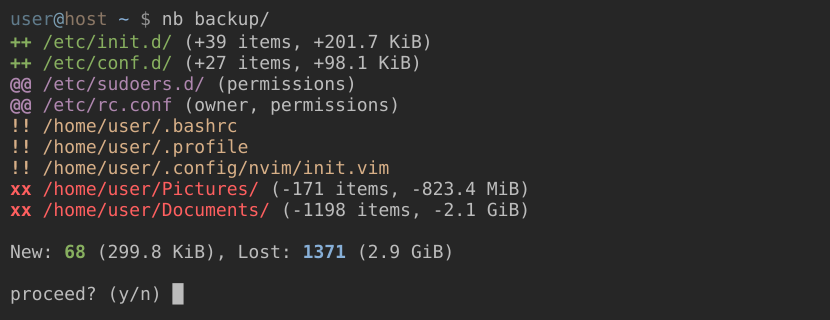

[](https://github.com/AlxHnr/nano-backup/actions/workflows/ci.yml)
[](https://codecov.io/github/AlxHnr/nano-backup?branch=master)
[](https://github.com/AlxHnr/nano-backup/blob/master/LICENSE)


The first thing nano-backup shows you when you do a backup are the changes
since the last backup. This allows you to review all the files you have
modified before _committing_ them. The goal here is to enable a fast
review-rollback-commit cycle, giving you precise control about the state of
your system.

## Installation

```sh
./scripts/build-release.sh
sudo cp ./build/nb /usr/local/bin/
```

## Usage

A repository is a directory with a file named `config` inside it:

```sh
mkdir repo/
vi repo/config
```

Here is an example config:

```ini
[mirror]
/home/user/Videos
/home/user/Pictures
```

The first line sets the mirror [policy](#policies). The other lines are
absolute paths to files or directories which should be backed up. To do a
backup, pass the repository to nano-backup:

```sh
nb repo/
```

To prevent files from being backed up, set the ignore policy. This allows
specifying regular expressions, which will be matched against full,
absolute filepaths. They must be valid POSIX extended regular expressions:

```ini
[ignore]
\.pyc$
^/home/user/.*/__pycache__$
```

Regular expressions can also be used for matching files you want to backup.
Just prefix a pattern with an additional slash:

```ini
[mirror]
/home/user//\.(png|jpg)$
/home//^(foo|bar)$/.bashrc
```

**Note**: These expressions will not match recursively and can be
terminated by a slash.

### Restoring files

Files can be restored like this:

```sh
nb repo/ 0 file.txt
```

_0_ is the id of the latest backup. The backup before it would be _1_, etc.

**Note**: This number will be ignored for copied/mirrored files, which will
always be restored to their latest state.

## Policies

Policies specify how files should be backed up. They apply only to the last
element of a path, but will match all files inside it recursively:

```ini
[policy]
/home/user/last-element
```

Policy name | Description
------------|-------------
copy        | Backup only the latest version of a file.
mirror      | Like copy, but if a file gets removed from the system, it will also be removed from the backup.
track       | Keep a full history of every change.
ignore      | Allows specifying regular expressions for excluding paths.
summarize   | Allows specifying regular expressions for directories which should not be listed recursively during backups.

## Frequently asked questions

### Is this project still maintained?

It is a finished project and no longer under development. While it lacks
some nice-to-have features, it is rock solid and ready for daily use.

### What are the limitations of this tool?

* No builtin file compression, encryption and cloud support, but see
  complementary tools below
* The restore feature is very primitive and you can't mount your backup
* It only supports whole-file deduplication instead of modern chunk-based
  deduplication
* Single-threaded

### How do I synchronize two repositories?

```sh
cp -rn current/* old/
cp current/config old/
cp current/metadata old/
nb old/ gc
```

### How do I encrypt my backup?

Backup either to a LUKS partition or to a gocryptfs directory.

### How do I backup to a cloud provider?

Pushing to the cloud requires third-party tools like rclone. Note that you
should not backup directly to a mounted cloud partition, because
nano-backup has no retry mechanism. While this will not cause any data
loss, having to retry manually is annoying. Instead, backup to a local
directory first and then sync it with rclone to a cloud mountpoint (ideally
with gocryptfs in-between):

```sh
rclone --config= sync --progress --inplace --ignore-existing /local/backup/ /cloud-mount/backup/
rclone --config= copyto --progress /local/backup/config /cloud-mount/backup/config
rclone --config= copyto --progress /local/backup/metadata /cloud-mount/backup/metadata
```

### Can I run a hook before/after each backup?

No, write a wrapper script instead:

```sh
#/bin/sh -e

... # Run stuff before the backup.

nb "$HOME/backup"

... # Run stuff after the backup.
```

### Can I tell it to do automatic backups once a day?

No, this is the task of tools like cron.
